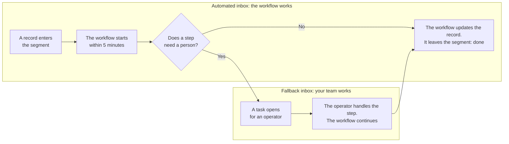

An automated inbox gives its records to a workflow instead of your team. Each time a record enters the inbox, the workflow processes it, with nobody clicking anything. Your team steps in only when the workflow needs a person.

For example, your `Documents` collection has a `Waiting for validation` segment. A new document enters the segment, the workflow checks it, sets its status to `Validated`, and the document leaves the segment. When the workflow cannot decide on its own, a task opens for an operator in another inbox, the fallback inbox.

## Key terms

- **Segment**: a saved filter on a collection, for instance the documents waiting for validation. A record is in the segment while it matches the filter.
- **Workflow**: a series of steps Forest runs on a record, such as checks, data updates, emails or actions.
- **Run**: one pass of the workflow on one record.
- **Check**: every 5 minutes, Forest looks for new records in the segment.
- **Fallback inbox**: a regular inbox where your operators handle the runs the workflow cannot finish alone.
- **Service account**: a Forest user that stands for the automation, not for a person. The workflow acts with its permissions.
- **Backend**: the server your developers run to connect Forest to your data.
- **Forest Runtime**: the Forest program your developers install on your own servers. It runs the workflows and checks the segment.
- **Backlog**: the inbox page that lists every record with its state.
- **Dispatch rule**: the order in which an inbox hands out its records, for instance oldest first.

## How it works

### Two inboxes, two roles

An automation always works with two inboxes: one for the workflow, one for your team.

| | Automated inbox | Fallback inbox |
|---|---|---|
| **What lands there** | Every record that matches the segment | A task for each run that needs a person: an error, a confirmation, a manual input |
| **What people do there** | Admins follow the progress | Operators take and finish tasks, like in any inbox |

<Info>
  An automated inbox has no **To do** or **Doing** page, no **Start processing** button and no **Next ticket** bar. Nobody takes its records: the workflow does. If someone tries, Forest refuses with *"Records of an automated inbox cannot be assigned or unassigned."*
</Info>

## Before you start

Check these points first. If one is missing, the settings tell you which one, but checking first saves a trip back.

1. **An inbox based on a segment.** An inbox that receives escalations from a workflow cannot become automatic.
2. **A workflow on the same collection**, with a **fallback inbox** selected in its **Triggers** section.
3. **The workflow's On data change trigger, turned on.** See [Workflow triggers](/product/process/workflows/triggers#the-on-data-change-trigger).
4. **A workflow that takes the record out of the segment.** See [the next section](#make-your-workflow-take-records-out-of-the-segment).
5. **A service account in the inbox's team.** The workflow runs as this account, with its permissions. Its role needs read access to the collections of both inboxes.
6. **[Forest Runtime](/product/process/workflows/forest-runtime)** running on your environment. Your developers install it.

Only the **Admin** and **Process Owner** permission levels set up an automated inbox. See [Who can do what](#who-can-do-what).

## Make your workflow take records out of the segment

This is the one rule that matters. A record leaves the automated inbox only when it leaves the segment: Forest has no other way to know the work is done.

Make sure the workflow ends with a data update or an action that changes what the segment filters on. The settings remind you under **Workflow**: *"Ensure your workflow contains a data update or action that takes the record out of the segment, otherwise it won't be marked as Done."*

<Tip>
  The `Waiting for validation` segment keeps the documents whose status is `pending`. The last step of the workflow, an **Update Data** step, sets the status to `validated`. The document leaves the segment, and the inbox marks it as done.
</Tip>

## Set up an automated inbox

<Tabs>
  <Tab title="New inbox">
    <Steps>
      <Step title="Create the inbox">
        Open the **Collaboration** tab and turn on **Layout Editor** mode. In the **Inboxes** section of the left navbar, click **Add New**, then pick the collection and the segment.
      </Step>
      <Step title="Let a workflow process the records">
        At the step **How are these records processed?**, pick **A workflow processes them**.
      </Step>
      <Step title="Pick the workflow">
        The **Workflow** list only shows the workflows whose On data change trigger is on.
      </Step>
      <Step title="Pick who it runs as">
        In **Runs as**, pick a service account. Every run starts with its permissions.
      </Step>
      <Step title="Check how many records will start">
        Forest counts the records already in the segment, for instance *"42 records already in this segment will start."* The workflow processes these records too: if it sends emails or payments, it sends them for these records. Above 100 records, the last step asks you to confirm.
      </Step>
      <Step title="Create the inbox">
        The workflow starts on the records already in the segment, then on every new one.
      </Step>
    </Steps>
  </Tab>
  <Tab title="Existing inbox">
    <Warning>
      Switching an existing inbox to automatic cancels the tasks operators hold in **Doing**, and aborts the workflow runs they started there. The settings warn you before you save: *"Tickets currently handled by users will be auto-cancelled."*

      The workflow then starts these records again at its next check. An aborted run keeps what it already did. If the workflow sends an email or a payment, the new run sends it again. Ask operators to finish their tasks in **Doing** before you switch.

      The cancelled tasks stay in the **Backlog** with their operator, in the **Automatically Canceled** state. The Backlog hides them by default: pick this state in its filter to see them.
    </Warning>

    <Steps>
      <Step title="Open the inbox settings">
        In **Layout Editor** mode, open the menu next to the inbox name.
      </Step>
      <Step title="Switch to automatic">
        In the **Process** section, set **How it starts** to **Automatically, as soon as a record enters**.
      </Step>
      <Step title="Pick the workflow and who it runs as">
        Pick the **Workflow**, then the service account in **Runs as**.
      </Step>
      <Step title="Check how many records will start">
        Under **How it starts**, Forest shows how many records already in the inbox will start, for instance *"Up to 42 records already in this inbox will start."*
      </Step>
      <Step title="Save">
        Above 100 records, or when operators hold tasks in this inbox, Forest asks you to confirm with **Switch to automatic**.
      </Step>
    </Steps>
  </Tab>
</Tabs>

After you save, the settings show *"Applying your changes… This can take up to 20 seconds."*, then **Automation is running.** Any other message means the automation is stopped: see [Status messages](#status-messages).

## What happens to each record

<AccordionGroup>
  <Accordion title="The workflow runs to the end and the record leaves the segment" icon="circle-check">
    The record leaves the inbox. Nobody had to do anything.
  </Accordion>
  <Accordion title="The workflow runs to the end, but the record stays in the segment" icon="circle-pause">
    The record stays **in progress** in the automated inbox. The workflow does not start again on it, and no task opens for your team. Fix the workflow, or move these records out of the segment with a bulk action.

    Past 100 records in this state, the automation stops starting new runs and shows *"More than 100 records are still in the segment after their run. No new run starts until your workflow takes them out of the segment."* It starts again on its own once the count is back to 100 or below.
  </Accordion>
  <Accordion title="A step needs a person" icon="user">
    A step errors, asks for a confirmation, or needs a manual input. A task opens in the fallback inbox, linked to the same run. The workflow keeps processing the other records meanwhile.

    The operator who takes the task resumes the run where it stopped, with everything the workflow already did. From then on, the automated steps run with that operator's permissions, not the service account's.

    The task stays with the operator until the run ends, even if the run blocks again. When the run ends, the task closes on its own. If the operator aborts the run and the record is still in the segment, the workflow starts again on it at the next check.

    If Forest Runtime stops in the middle of a step that changes data, the task shows *"Step execution was interrupted. Please retry the step manually."* Retry the step from the task. Forest never replays it on its own, so nothing runs twice.
  </Accordion>
  <Accordion title="The record leaves the segment, then comes back" icon="rotate">
    The workflow starts a new run on it. If the record leaves and comes back between two checks, Forest never sees it leave, and no new run starts.
  </Accordion>
  <Accordion title="Someone already runs the same workflow on the record" icon="hourglass">
    A record never runs the same workflow twice at the same time. If an operator, a webhook or an AI assistant already started this workflow on the record, the automation waits for that run to end.
  </Accordion>
  <Accordion title="The record belongs to two automated inboxes" icon="clone">
    Each inbox runs its own workflow on it. When both inboxes use the same workflow, the second run waits for the first one to end. It then starts if the record is still in its segment, so the record goes through the workflow twice. Keep the segments apart when the workflow sends an email or a payment.
  </Accordion>
</AccordionGroup>

### How fast records start

- Forest checks the segment for new records **every 5 minutes**. Your developers change this interval in [Forest Runtime](/product/process/workflows/forest-runtime#tuning).
- Each inbox runs at most **20 workflows** at the same time. The other records wait for the next check. Runs waiting on a person in the fallback inbox do not count.
- Records start in the same order the inbox would give them to operators, set by its dispatch rule, for instance oldest first. With a random dispatch rule, the order is not guaranteed.

<Note>
  On forest-express and agent-php backends, records start in the order of the dispatch rule's first sort field only. Your developers know which backend you use.
</Note>

## Follow and unstick records

Admins open an automated inbox from the left navbar, where a bolt icon marks it. It opens on its **Backlog**, which lists every record of the segment with its state. The header sums up the automation, for instance *"Automatic · Running · Workflow: Validate document · Service account: Validation bot"*.

Other roles do not see the automated inbox in the navbar, except in **Layout Editor** mode, where it opens its settings.

In the Backlog, every record with a run going shows as **in progress**: the ones waiting on a person in the fallback inbox, and the ones whose run ended while they stayed in the segment, look the same.

To unstick a record that stays **in progress**, abort its run:

1. Open the record.
2. Resume its workflow run. This only opens the run.
3. Close the workflow panel and choose **Abort**.

If the record is still in the segment, the workflow starts again on it at the next check.

## Pause the automation

Pause an automated inbox when something goes wrong, for instance a workflow that misbehaves, without losing its settings.

1. In **Layout Editor** mode, open the inbox settings.
2. At the top of the automation settings, click **Pause**.

The pause applies at once, with no **Save**, and Forest confirms with *"Automation paused."* The settings then read *"Paused. No new run starts until you resume it; runs already going finish as usual."*

While the inbox is paused:

- **No new run starts.** The runs already going finish as usual, and the ones that need a person still go to the fallback inbox.
- **The inbox stays automated.** Operators still cannot take its records, and its workflow, service account and dispatch order stay as they are.
- **Everyone sees the pause.** The Backlog shows *"The automation is paused. No new run starts until it is resumed."*, its header and the workflow's **On data change** row say **Paused**, and the navbar tooltip reads *"Automatic inbox, paused"*.

Click **Resume** to start again. The records that entered the segment meanwhile start at the usual pace, with no count and no confirmation.

A workflow that fails on every record fills the fallback inbox with up to 20 tasks every 5 minutes. Pause the automation, fix the workflow, then resume.

<Tip>
  Pause works even when an error has already stopped the automation. A pause set in production stays in place when your developers deploy a branch. Use it as the emergency stop.
</Tip>

## Change or stop the automation

To stop for a while and keep the settings, [pause](#pause-the-automation) instead.

| To | Do this | What happens to the runs already started |
|---|---|---|
| Stop the automation | In the inbox settings, set **How it starts** to **Operators handle the records, no workflow** | They keep going and close on their own when they end. Operators work the inbox again. |
| Change the workflow or the service account | Pick another one in the inbox settings and save | They keep going. New runs use the new settings. |
| Turn off the workflow's **On data change** trigger | In the workflow's **Triggers** section | They keep going. Every automated inbox using this workflow stops, and the trigger row lists them, for instance *"2 inboxes stopped: Documents, Invoices."* |
| Delete the automated inbox | In the inbox menu, in **Layout Editor** mode | They keep going, and the ones that need a person still go to the fallback inbox. |
| Delete the service account | In **Project settings** → **Service accounts** | They keep going, and operators still unblock them from the fallback inbox. The confirmation lists the automated inboxes that will stop. |

<Note>
  Forest refuses to delete a fallback inbox while a workflow with an automated trigger sends its runs there. First turn off that workflow's automated triggers, or pick another fallback inbox for it.
</Note>

## Status messages

The top of the inbox's automation settings shows **Automation is running.** when everything works, or **Paused.** after a [pause](#pause-the-automation). Any other message shows at the bottom of the automation settings. These messages stop the automation until someone fixes their cause, and most of them come with a link to the right page.

<Info>
  A change takes a moment to apply, and the status updates at the next check, within 5 minutes. If Forest Runtime stops, the settings keep showing the last status they received. If a status looks outdated, refresh the page.
</Info>

### Setup to finish

| Message | What to do | Who |
|---|---|---|
| *Save to check this automation.* | Save the settings. | You |
| *Choose the service account the runs are started as.* | Pick a service account in **Runs as**. | Admin or Process Owner |
| *Won't start until an Admin or a Process Owner picks who it runs as.* | Ask an Admin or a Process Owner to pick **Runs as**. | Admin or Process Owner |
| *No Forest Runtime is connected to this environment.* | Install [Forest Runtime](/product/process/workflows/forest-runtime). | Your developers |
| *Your Forest Runtime is missing or too old to run automated inboxes.* | Update Forest Runtime. | Your developers |

### The service account

| Message | What to do | Who |
|---|---|---|
| *The user this automation runs as is not a service account. Choose a service account to start it again.* | Pick a service account in **Runs as**. | Admin or Process Owner |
| *The user this automation runs as no longer exists.* | Pick another service account in **Runs as**. | Admin or Process Owner |
| *The user this automation runs as is blocked.* | Unblock it in **Project settings** → **Users**, or pick another one in **Runs as**. | Admin |
| *The user this automation runs as is not a member of this team.* | Add it to the inbox's team in **Project settings** → **Users**, or pick another one in **Runs as**. | Admin |
| *The role of the user this automation runs as is disabled on this environment.* | Enable the role in **Project settings** → **Roles**, or pick another service account. | Admin |
| *The user this automation runs as can't read this inbox's collection.* | Give its role read access to the collection in **Project settings** → **Roles**. | Admin |
| *The user this automation runs as can't read the collection of this workflow's fallback inbox.* | Give its role read access to that collection in **Project settings** → **Roles**. | Admin |

### The workflow and the segment

| Message | What to do | Who |
|---|---|---|
| *This workflow can't start automatically. Turn on its "On data change" trigger.* | In the workflow's **Triggers** section, turn on **On data change**, or pick another workflow. | Admin or Process Owner |
| *The selected workflow no longer exists or has no fallback inbox.* | Pick a fallback inbox in the workflow's **Triggers** section, or pick another workflow. | Admin or Process Owner |
| *The selected workflow runs on another collection than this inbox.* | Pick a workflow on the inbox's collection. | You |
| *This workflow's fallback inbox no longer exists. Choose another one.* | Pick another fallback inbox in the workflow's **Triggers** section. | Admin or Process Owner |
| *This workflow's fallback inbox is automated. Choose a fallback inbox people work from.* | Pick a fallback inbox your operators work from, in the workflow's **Triggers** section. | Admin or Process Owner |
| *More than 100 records are still in the segment after their run. No new run starts until your workflow takes them out of the segment.* | Fix the workflow so it takes records out of the segment, then move the records stuck in it. See [Make your workflow take records out of the segment](#make-your-workflow-take-records-out-of-the-segment). | Admin or Process Owner |
| *The collection or segment of this inbox is no longer available.* | Restore the segment, or create a new automated inbox on another one. | Admin or Process Owner |
| *The segment filter cannot be evaluated by the Forest Runtime.* | Find out which part of the segment filter Forest Runtime cannot read, or rebuild the segment with simpler conditions. | Your developers |

### Your backend

These messages clear on their own at the first check that reads the segment again.

| Message | What to do | Who |
|---|---|---|
| *Your backend refused to let the service account read this inbox's segment.* | Give the service account's role read access to the collection in **Project settings** → **Roles**. | Admin |
| *Your backend could not be reached when checking this inbox. Check that it is running.* | Check that the backend is running. | Your developers |
| *Your backend could not read this inbox's segment.* | Check the segment on the backend, with the error code shown in the message when there is one. | Your developers |
| *This automation cannot run right now.* | Contact Forest support. | You |

## Who can do what

| Action | Admin | Process Owner | Developer, Editor | Manager, User |
|---|:-:|:-:|:-:|:-:|
| Make an inbox automatic | ✅ | ✅ | — | — |
| Change the workflow of an automated inbox | ✅ | ✅ | ✅ | — |
| Switch an automated inbox back to operators | ✅ | ✅ | ✅ | — |
| Pick **Runs as** | ✅ | ✅ | — | — |
| Turn the workflow's **On data change** trigger on or off | ✅ | ✅ | — | — |
| Pause and resume the automation | ✅ | ✅ | ✅ | — |
| Open the automated inbox's **Backlog** | ✅ | — | — | — |
| See the automated inbox in the navbar | ✅ | Layout Editor mode | Layout Editor mode | — |
| Work the fallback inbox | ✅ | ✅ | ✅ | ✅ |

## Related

<CardGroup cols={2}>
  <Card title="Inbox" icon="inbox" href="/product/manage/inbox">
    How operators process tasks in an inbox.
  </Card>
  <Card title="Workflow triggers" icon="bolt" href="/product/process/workflows/triggers">
    Manual, webhook, MCP and On data change.
  </Card>
  <Card title="Forest Runtime" icon="server" href="/product/process/workflows/forest-runtime">
    The service that runs workflows and watches automated inboxes.
  </Card>
  <Card title="Executing workflows" icon="play" href="/product/execute/workflows">
    How operators resume and abort a run.
  </Card>
</CardGroup>
